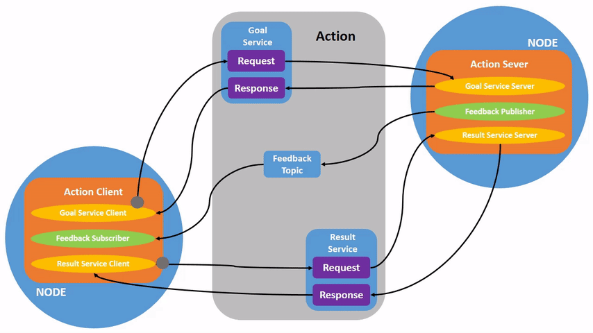

# 07. ROS service, ROS action fogalma, felhasználása

---


## Elmélet

--- 


### ROS Service

- Request/reply communication
- Use a client-server model
- Similar to Remote Procedure Calls (RPC)
- Blocking behavior by default (can be async)

#### ROS `.srv` files


```bash
int a
int b
---
int sum
```

```bash
#request constants
int8 FOO=1
int8 BAR=2
#request fields
int8 foobar
another_pkg/AnotherMessage msg
---
#response constants
uint32 SECRET=123456
#response fields
another_pkg/YetAnotherMessage val
CustomMessageDefinedInThisPackage value
uint32 an_integer
```

---

### ROS Action

{ width="800" }

<small>
Forrás: [ROS 2 Documentation](https://docs.ros.org/en/jazzy/Tutorials/Beginner-CLI-Tools/Understanding-ROS2-Actions/Understanding-ROS2-Actions.html).
Licenc: [CC BY 4.0](https://creativecommons.org/licenses/by/4.0/).
</small>

- Ideal for communication with slower processes, e.g. environmental inetarcion
- Asynchronous communication (non-blocking)
- Actions consist of a goal, feedback, and a result
- Built on topics and services and function similarly to services
- Actions are preemptable, (can be canceled while executing)
- Provide steady feedback, unlike services which return a single response
- Actions use a client-server model, similar to the publisher-subscriber model
- An *action client* node sends a goal to an *action server* node that acknowledges the goal and returns a stream of feedback and a result.


#### ROS `.action` files

```bash
# Define the goal
uint32 dishwasher_id  # Specify which dishwasher we want to use
---
# Define the result
uint32 total_dishes_cleaned
---
# Define a feedback message
float32 percent_complete
```

---

### Building custom interfaces (`.msg` , `.srv` and `.action` files)

- `CMakeList.txt` and `package.xml` need to be modified
- For messages and services, see [https://docs.ros.org/en/foxy/Tutorials/Beginner-Client-Libraries/Custom-ROS2-Interfaces.html](https://docs.ros.org/en/foxy/Tutorials/Beginner-Client-Libraries/Custom-ROS2-Interfaces.html)
- For actions, see [https://docs.ros.org/en/foxy/Tutorials/Intermediate/Creating-an-Action.html](https://docs.ros.org/en/foxy/Tutorials/Intermediate/Creating-an-Action.html)


---

## Gyakorlat

### 1. ROS Service-ek használata Turtlesimben

1. Indítsunk el egy Turtlesim szimulátort, majd külön terminálban a billentyűzetes vezérlést:

    ```bash
    ros2 run turtlesim turtlesim_node
    ```

    ```bash
    ros2 run turtlesim turtle_teleop_key
    ```


2. Vizsgáljuk meg az elérhető Service-eket és a hozzájuk tartozó interfészeket:

    ```bash
    ros2 service list -t
    ros2 service type /spawn
    ros2 interface show turtlesim/srv/Spawn
    ros2 node info /turtlesim
    ```

3. Hozzunk létre egy második teknőst a `(2.0, 2.0)` pozícióban:

    ```bash
    ros2 service call /spawn turtlesim/srv/Spawn "{x: 2.0, y: 2.0, theta: 0.0, name: 'turtle2'}"
    ```

4. Figyeljük meg a választ, majd töröljük a második teknőst:

    ```bash
    ros2 service call /kill turtlesim/srv/Kill "{name: 'turtle2'}"
    ```


---

### 2. Saját Python Service Server: a teknős pozíciójának ellenőrzése

Készítsünk olyan ROS node-ot, amely a `/turtle1/pose` topicról olvassa a teknős pozícióját, és a `/check_position` Service-en keresztül megállapítja, hogy a teknős a `(5.5, 5.5)` középponttól legfeljebb `2.0` egységre van-e.

A szerver a `std_srvs/srv/Trigger` típust használja: a kérés üres, a válasz `success` mezője jelzi a feltétel teljesülését, a `message` pedig a mért távolságot tartalmazza.

1. Hozzuk létre a `position_checker.py` fájlt a meglévő `ros2_course` Python-csomagban. Adjuk hozzá az új entry point-ot a `setup.py`-hoz.

    ```python
    import math
    import rclpy
    from rclpy.node import Node
    from turtlesim.msg import Pose
    from std_srvs.srv import Trigger


    class PositionChecker(Node):

        def __init__(self):
            super().__init__('position_checker')

            self.pose = None

            # Subscriber: aktuális teknőspozíció
            self.pose_sub = self.create_subscription(
                Pose,
                '/turtle1/pose',
                self.pose_callback,
                10
            )

            # Service Server
            self.service = self.create_service(
                Trigger,
                '/check_position',
                self.check_position_callback
            )

        def pose_callback(self, msg):
            self.pose = msg

        def check_position_callback(self, request, response):
            if self.pose is None:
                response.success = False
                response.message = 'No pose received.'
                return response

            # TODO 1: számítsuk ki a távolságot az (5.5, 5.5) ponttól!
            distance = ...

            # TODO 2: igaz-e, hogy a távolság legfeljebb 2.0?
            response.success = ...
            response.message = f'Distance: {distance:.2f}'

            return response


    def main(args=None):
        rclpy.init(args=args)
        node = PositionChecker()

        try:
            rclpy.spin(node)
        except KeyboardInterrupt:
            pass
        finally:
            node.destroy_node()
            if rclpy.ok():
                rclpy.shutdown()


    if __name__ == '__main__':
        main()
    ```

2. Egészítsük ki a két `TODO` sort! 


3. Győződjünk meg róla, hogy a `package.xml` tartalmazza a futásidejű függőségeket:

    ```xml
    <exec_depend>rclpy</exec_depend>
    <exec_depend>turtlesim</exec_depend>
    <exec_depend>std_srvs</exec_depend>
    ```

4. Fordítsuk a csomagot, majd futtassuk az új node-ot (a Turtlesim maradjon elindítva):

    ```bash
    cd ~/ros2_ws
    colcon build --symlink-install
    ros2 run ros2_course position_checker
    ```

    Egy másik terminálban vizsgáljuk meg a Service-t, majd hívjuk meg:

    ```bash
    ros2 service list -t
    ros2 service type /check_position
    ros2 interface show std_srvs/srv/Trigger
    ros2 service call /check_position std_srvs/srv/Trigger "{}"
    ```

    Mozgassuk el a teknőst a billentyűzetes vezérléssel, és ismételjük meg a hívást. Figyeljük meg, hogyan változik a `success` érték és a távolság!


---

### 3. ROS Action kipróbálása Turtlesimben

Az Action működését most parancssorból vizsgáljuk meg. Saját Action Server és Action Client implementálása nem szükséges.

1. Indítsuk el a Turtlesim és a billentyűzetes vezérlés node-jait, ha még nem futnak:

    ```bash
    ros2 run turtlesim turtlesim_node
    ```

    ```bash
    ros2 run turtlesim turtle_teleop_key
    ```

2. Vizsgáljuk meg az Action-öket:

    ```bash
    ros2 action list -t
    ros2 action info /turtle1/rotate_absolute
    ros2 interface show turtlesim/action/RotateAbsolute
    ```

3. Küldjünk célszöget az Action Servernek, és kérjük a feedback megjelenítését:

    ```bash
    ros2 action send_goal /turtle1/rotate_absolute turtlesim/action/RotateAbsolute "{theta: 3.14}" --feedback
    ```

    Próbáljunk ki más célszöget is, például `1.57` radiánt. A `turtle_teleop_key` termináljában használható abszolút forgatási billentyűk hatását is megfigyelhetjük.


---

## Hasznos linkek

- [ROS 2 Jazzy – Understanding services](https://docs.ros.org/en/jazzy/Tutorials/Beginner-CLI-Tools/Understanding-ROS2-Services/Understanding-ROS2-Services.html)
- [ROS 2 Jazzy – Writing a simple service and client (Python)](https://docs.ros.org/en/jazzy/Tutorials/Beginner-Client-Libraries/Writing-A-Simple-Py-Service-And-Client.html)
- [ROS 2 Jazzy – Understanding actions](https://docs.ros.org/en/jazzy/Tutorials/Beginner-CLI-Tools/Understanding-ROS2-Actions/Understanding-ROS2-Actions.html)
- [ROS 2 Jazzy – Creating custom interfaces](https://docs.ros.org/en/jazzy/Tutorials/Beginner-Client-Libraries/Custom-ROS2-Interfaces.html)
- [ROS 2 Jazzy – Writing an action server and client (Python)](https://docs.ros.org/en/jazzy/Tutorials/Intermediate/Writing-an-Action-Server-Client/Py.html)
- [ROS 2 examples (GitHub)](https://github.com/ros2/examples)