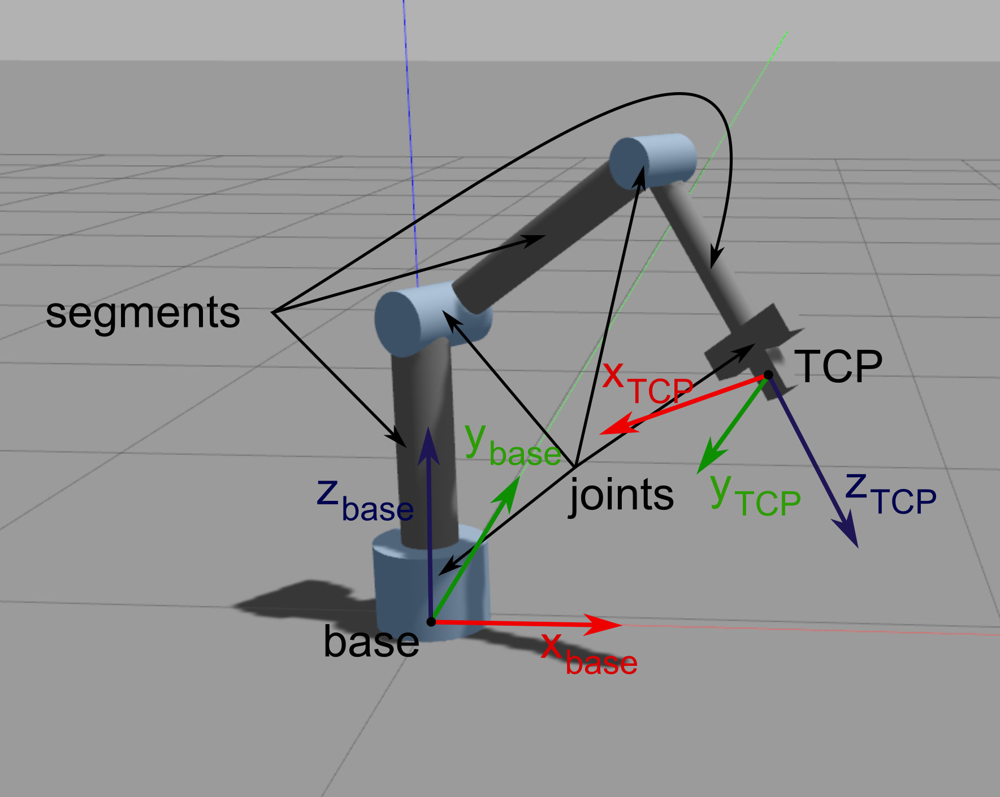
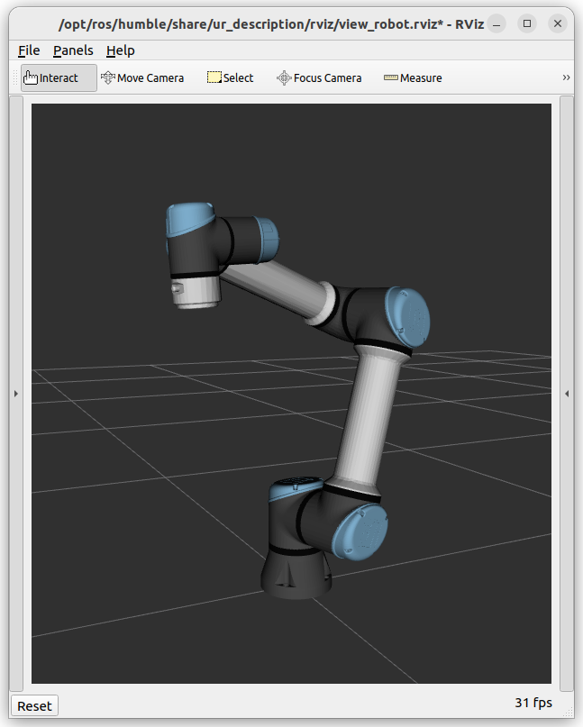

# 08. Kinematika, inverz kienamtika, Szimulált robotkar programozása csukló-, és munkatérben

---

!!! warning
    **ZH2** **december 4.** **10:45** **F.04 terem**

## Ismétlés

---


### 3D transzformációk

---


- **Pozíció:** 3 elemű offszet vektor 
{:style="width:250px" align=right}
- **Orientáció:** 3 x 3 rotációs matrix
    - további orientáció reprezentációk: Euler-szögek, RPY, angle axis, quaternion

- **Helyzet** (pose): 4 × 4 transzformációs mártrix
- **Koordináta rendszer** (frame): null pont, 3 tengely, 3 bázis vektor, jobbkéz-szabály
- **Homogén transzformációk:** rotáció és transzláció együtt
    - pl. $\mathbf{R}$ rotáció és $\mathbf{v}$ transzláció esetén:

$$
\mathbf{T} = \left[\matrix{\mathbf{R} & \mathbf{v}\\\mathbf{0} & 1 }\right] = \left[\matrix{r_{1,1} & r_{1,2} & r_{1,3} & v_x\\r_{2,1} & r_{2,2} & r_{2,3} & v_y\\r_{3,1} & r_{3,2} & r_{3,3} & v_z\\\ 0 & 0 & 0 & 1 }\right]
$$

- **Homogén koordináták:** 
    - **Vektor:** 0-val egészítjük ki, $\mathbf{a_H}=\left[\matrix{\mathbf{a} \\ 0}\right]=\left[\matrix{a_x \\ a_y \\ a_z \\ 0}\right]$
    - **Pont:** 1-gyel egészítjük ki, $\mathbf{p_H}=\left[\matrix{\mathbf{p} \\ 1}\right]=\left[\matrix{p_x \\ p_y \\ p_z \\ 1}\right]$
    - Transzformációk alkalmazása egyszerűbb:

$$
\mathbf{q} = \mathbf{R}\mathbf{p} + \mathbf{v} \to \left[\matrix{\mathbf{q} \\ 1}\right] = \left[\matrix{\mathbf{R} & \mathbf{v}\\\mathbf{0} & 1 }\right]\left[\matrix{\mathbf{p} \\ 1}\right]
$$

- **Szabadsági fok** (DoF): egymástól független mennyiségek száma.

---

### Robotikai alapok

---

{:style="width:400px" align=right}

- Robotok felépítése: **szegmensek** (segment, link) és **csuklók** (joints)
- **Munkatér** (task space, cartesian space):  
    - Háromdimenziós tér, ahol a feladat, trajektóriák, akadályok, stb. definiálásra kerülnek.
    - **TCP** (Tool Center Point): az end effektorhoz rögzített koordináta rendszer (frame)
    - **Base/world frame**
- **Csuklótér** (joint space):
    -  A robot csuklóihoz rendelt mennyiségek, melyeket a robot alacsony szintű irányító rendszere értelmezni képes.
    -  csukló koordináták, sebességek, gyorsulások, nyomatékok...


---

## Elmélet

--- 


### Kinematika, inverz kinematika

---

#### Kinematika

!!! abstract "Def. Kinematika"
    A TCP (vagy bármi más) helyzetének kiszámítása a csukló koordinátákból.


- Kinematikai modell
    - Denavit--Hartenberg (DH) konvenció
    - URDF (Unified Robotics Description Format, XML-alapú)
    
Ha a segmensekhez rendelt koordináta rendszerek rendre $base, 1, 2, 3, ..., TCP$, a szomszédos $i$ and $i+1$ szegmensek közötti transzfomrációk $T_{i+1,i}(q_{i+1})$ (mely a közbezárt csukló szögének függvénye), a transzfomráció a base frame és a TCP között felírható ($n$ csuklós robotra):
 
$$
     T_{TCP,base}(q_1, \cdots, q_n) = T_{TCP,n-1}(q_{n}) \cdot T_{n-1,n-2}(q_{n-1}) \cdots T_{2,1}(q_2) \cdot T_{1,base}(q_1) \cdot base
$$

---

#### Inverz kinematika

!!! abstract "Def. Inverz kinematika"
    Csukló koordináták kiszámítása a (kívánt)  TCP (vagy bármi más) pose eléréséhez.

---

#### Differenciális inverz kinematika


!!! abstract "Def. Differenciális inverz kinematika"
    A csukló koordináták mely változtatása éri el a kívánt, **kis mértékű változást** a TCP helyzetében (rotáció és transzláció).
    
    
- **Jacobi-mátrix** (Jacobian): egy vektorértékű függvény elsőrendű parciális deriváltjait tartalmazó mátrix. 


    $$
    \mathbf{J} = \left[\matrix{\frac{\partial x_1}{\partial q_1} & \frac{\partial x_1}{\partial q_2} &\frac{\partial x_1}{\partial q_3} & \dots &\frac{\partial x_1}{\partial q_n} \\
    \frac{\partial x_2}{\partial q_1} & \frac{\partial x_2}{\partial q_2} &\frac{\partial x_2} {\partial q_3} & \dots &\frac{\partial x_2}{\partial q_n} \\
    \frac{\partial x_3}{\partial q_1} & \frac{\partial x_3}{\partial q_2} &\frac{\partial x_3}{\partial q_3} & \dots &\frac{\partial x_3}{\partial q_n} \\
    \vdots &\vdots &\vdots &\ddots &\vdots \\
    \frac{\partial x_m}{\partial q_1} & \frac{\partial x_m}{\partial q_2} &\frac{\partial x_m}{\partial q_3} & \dots &\frac{\partial x_m}{\partial q_n} \\}\right]
    $$

 
- **Jacobi-mátrix jelentősége robotikában**: megadja az összefüggést a csuklósebességek és a TCP sebessége között.

    $$
    \left[\matrix{\mathbf{v} \\ \mathbf{\omega}}\right] =\mathbf{J}(\mathbf{q})\cdot \mathbf{\dot{q}}
    $$

    ,ahol $\mathbf{v}$ a TCP lineáris sebessége, $\mathbf{\omega}$ a TCP szögsebessége, $\mathbf{q}$ pedig a robot konfigurációja.


!!! abstract "Def. Konfiguráció"
    A robot pillanatnyi csuklószögeiből képzett vektor vagy tömb.


---

#### Inverz kinematika Jacobi inverz felhasználásával

1. Számítsuk ki a kívánt és az aktuális pozíció különbségét: $\Delta\mathbf{r} = \mathbf{r}_{desired} - \mathbf{r}_0$
2. Számítsuk ki a rotációk különbségét: $\Delta\mathbf{R} = \mathbf{R}_{desired}\mathbf{R}_{0}^{T}$, majd konvertáljuk át axis angle reprezentációba $(\mathbf{t},\phi)$
3. Számítsuk ki $\Delta\mathbf{ q}=\mathbf{J}^{-1}(\mathbf{q_0})\cdot \left[\matrix{k_1 \cdot \Delta\mathbf{r} \\ k_2 \cdot \mathbf{\omega}}\right]$, ahol az inverz lehet pszeudo-inverz, vagy transzponált
4. $\mathbf{q}_{better} = \mathbf{q}_{0} + \Delta\mathbf{q}$


---

## *Gyakorlat*

---

### *1: UR install*

---

1. Telepítsük a dependency-ket és a UR drivert.

    {:style="width:280px" align=right}

    ```bash
    sudo apt update
    sudo apt upgrade
    sudo apt-get install ros-jazzy-ur python3-pip
    pip3 install kinpy --break-system-packages
    ```

    !!! tip
    A `kinpy` csomag forrását is töltsük le, hasznos lehet az API megértése szempontjából: [https://pypi.org/project/kinpy/](https://pypi.org/project/kinpy/)

    ---

2. Indítsuk el a robot vizualizációját, majd mozgassuk a csuklókat a Joint State Publisher GUI segítségével.

    ```bash
    ros2 launch ur_description view_ur.launch.py ur_type:=ur5e
    ```

    !!! tip
        Próbáljunk ki más robotokat is a `ur_type` argumentum beállításával, például:

        `ur3`, `ur3e`, `ur5`, `ur5e`, `ur10`, `ur10e`, `ur16e`, `ur20`

---

### 2: Robot mozgatása csuklótérben

---

1. Hozzunk létre új Python forrásfájlt `ur_controller.py` névvel a     `~/ros2_ws/src/ros2_course/ros2_course` mappában.

    Adjuk meg az új entry pointot a `setup.py`-ban a megszokott módon.

    Iratkozzunk fel a robot csuklószögeit (konfigurációját) publikáló topicra, majd hozzunk létre publishert a csuklók szögeinek beállítására használható topichoz.

    ```text
    /joint_states
    /set_joint_states
    ```

    ---

2. Mozgassuk a robotot

    ```text
    q = [-1.28, 4.41, 1.54, -1.16, -1.56, 0.0]
    ```

    konfigurációba.

---

### 3. Kinematika ROS 2 QoS

---

1. A robotot leíró URDF-et a `robot_state_publisher` a

    ```text
    /robot_description
    ```

    topicon publikálja.

    Ellenőrizzük a topic tulajdonságait:

    ```bash
    ros2 topic info /robot_description --verbose
    ```

    Figyeljük meg a publisher QoS-beállításait, különösen a `Durability` értékét.

    A `robot_state_publisher` a `/robot_description` topicot **TRANSIENT_LOCAL** durabilityvel publikálja. Ez azt jelenti, hogy a publisher megőrzi az utolsó üzenetet, így egy később elinduló, megfelelő QoS-beállítású subscriber is megkaphatja az URDF-et.

    ---

2. Próbáljuk ki az alábbi egyszerű subscribert:

    ```python
    self.subscription = self.create_subscription(
        String,
        '/robot_description',
        self.robot_description_callback,
        10
    )
    ```

    Indítsuk el a node-ot úgy, hogy a `robot_state_publisher` már fut.

    Figyeljük meg, hogy a callback nem feltétlenül kapja meg a korábban publikált URDF-et.

    !!! tip
        A `10` nem maga a teljes QoS-beállítás. Ez a QoS history queue mélységét adja meg. A többi QoS tulajdonság alapértelmezett értéket kap.

    ---

3. Állítsunk be explicit QoS profilt a `/robot_description` topichoz.

    ```python
    from rclpy.qos import QoSProfile
    from rclpy.qos import ReliabilityPolicy
    from rclpy.qos import DurabilityPolicy
    ```

    Hozzunk létre egy QoS profilt:

    ```python
    robot_description_qos = QoSProfile(
        depth=1,
        reliability=ReliabilityPolicy.RELIABLE,
        durability=DurabilityPolicy.TRANSIENT_LOCAL,
    )
    ```

    és használjuk ezt a subscriber létrehozásakor:

    ```python
    self.subscription = self.create_subscription(
        String,
        '/robot_description',
        self.robot_description_callback,
        robot_description_qos
    )
    ```

    ---

4. Magyarázzuk meg a QoS-beállításokat.

    A legfontosabb QoS tulajdonságok ebben a példában:

    | QoS beállítás | Jelentése |
    |---|---|
    | `RELIABLE` | Az üzenetek megbízható kézbesítésére törekszik. |
    | `VOLATILE` | A subscriber csak a csatlakozása után publikált üzeneteket kapja meg. |
    | `TRANSIENT_LOCAL` | A publisher megőrzi az utolsó üzenetet, amit egy később csatlakozó, megfelelő subscriber is megkaphat. |
    | `depth` | A history queue-ban tárolt üzenetek száma. |

    A `/robot_description` esetében a `TRANSIENT_LOCAL` azért hasznos, mert az URDF nem folyamatos adatfolyam: a robot leírása általában egyszer kerül publikálásra, de az azt feldolgozó node-ok később is elindulhatnak.

    ---

5. Ellenőrizzük a működést.

    Az URDF-et tartalmazó topic lekérdezése explicit QoS-beállítással:

    ```bash
    ros2 topic echo /robot_description \
        --qos-durability transient_local \
        --qos-reliability reliable \
        --once
    ```

    A saját node-unkat akár az UR vizualizáció elindítása után is elindíthatjuk. A megfelelő `TRANSIENT_LOCAL` QoS miatt a subscriber megkapja a korábban publikált URDF-et.

    ---

6. Importáljuk a `kinpy` csomagot, és hozzuk létre a kinematikai láncot a robotot leíró URDF alapján az előbb implementált callback függvényben:

    ```python
    import kinpy as kp

    # ...

    self.chain = kp.build_serial_chain_from_urdf(
        self.desc,
        'tool0'
    )

    print(self.chain.get_joint_parameter_names())
    print(self.chain)
    ```

    ---

7. Számítsuk ki, majd írassuk ki a TCP pozícióját az adott konfigurációban a `kinpy` csomag segítségével.

    ```python
    p = chain.forward_kinematics(q)
    ```

    Vizsgáljuk meg a kapott transzformációt, és keressük meg benne a TCP pozícióját és orientációját.
---

### 4: Inverz kinematika Jacobi inverz módszerrel

---

Írjunk metódust, amely az előadásban bemutatott Jakobi inverz módszerrel valósítja meg az inverz kinematikai feladatot a roboton. 
Az orientációt hagyjuk figyelmen kívül. Mozgassuk a TCP-t a `(0.50, -0.60, 0.20)` pozícióba.

1.  Írjunk egy ciklust, melynek megállási feltétele a `delta_r` megfelelő nagysága és `rclpy.ok()`.

    ---

2. Számítsuk ki a kívánt és a pillanatnyi TCP pozíciók különbségét (`delta_r`). Skálázzuk `k_1` konstanssal.

    ---

3. `omega` legyen `[0.0, 0.0, 0.0]` (ignoráljuk az orientációt).

    ---

4. Konkatenáljuk `delta_r` és `omega`-t.

    ---

5. Számítsuk ki a Jacobi mátrixot az adott konfigurációban a `kp.jacobian.calc_jacobian(...)` függvény segítségével.

    ---

6. Számítsuk ki Jacobi mátrix pszeudo-inverzét `np.linalg.pinv(...)`.

    ---
    
7. A fenti képlet segítségével számítsük ki `delta_q`-t.

    ---

8. Növeljük a csuklószögeket a kapott értékekkel.


    ---


Ábrázoljuk a TCP trajektóriáját Matplotlib segítségével.

```python
import matplotlib.pyplot as plt

# ...

# Plot trajectory
ax = plt.figure().add_subplot(projection='3d')
ax.plot(x, y, z, label='TCP trajectory',  ls='-', marker='.')
ax.legend()
ax.set_xlabel('x [m]')
ax.set_ylabel('y [m]')
ax.set_zlabel('z [m]')
plt.show()
```
   

---

### *Bónusz:* Inverz kinematika orientációval

---

Egészítsük ki az előző feladat megoldását úgy, hogy az orientációt is figyelembe vesszük az inverz kinematikai számítás során.


---

## Hasznos linkek

- [ros-jazzy-ur documentation](https://docs.ros.org/en/jazzy/p/ur_robot_driver/)
- [https://github.com/UniversalRobots/Universal_Robots_ROS2_Driver/tree/humble]()
- [https://docs.ros.org/en/ros2_packages/humble/api/ur_robot_driver/usage.html#usage-with-official-ur-simulator]()
- [https://github.com/UniversalRobots/Universal_Robots_Client_Library]()
- [https://pypi.org/project/kinpy/](https://pypi.org/project/kinpy/)
- [https://en.wikipedia.org/wiki/Axis%E2%80%93angle_representation](https://en.wikipedia.org/wiki/Axis%E2%80%93angle_representation)
- [https://www.rosroboticslearning.com/jacobian](https://www.rosroboticslearning.com/jacobian)


